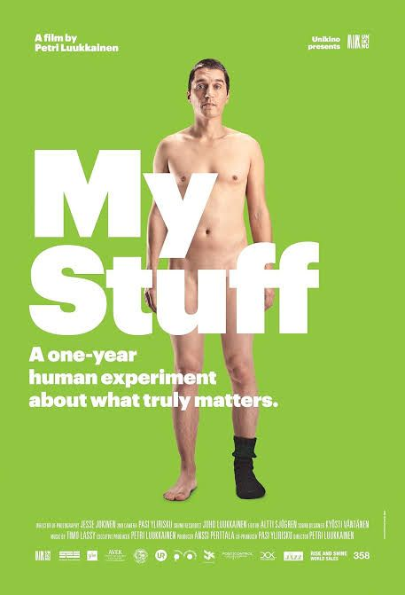
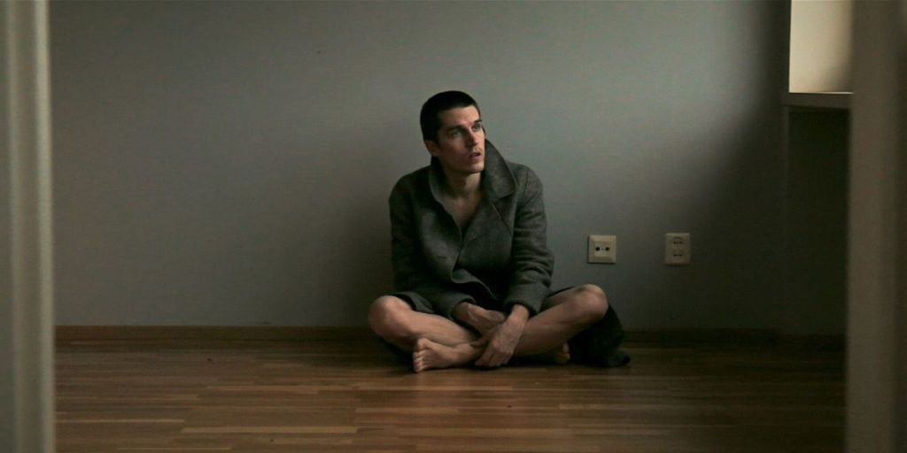
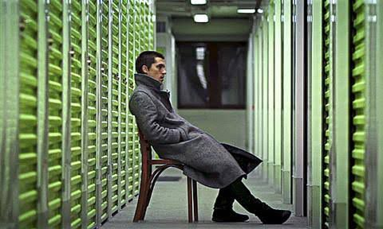

FICO – My Stuff is a quietly unsettling documentary that turns its lens on something most of us rarely question: why we own what we own. At first glance, the film appears to be about personal possessions, but it quickly reveals itself as a broader critique of consumer culture, identity, and the stories we tell ourselves through objects. 

<figure class="wp-block-image size-large"></figure>

 The documentary follows FICO, a self-described collector whose life is defined by accumulation. Rooms fill, shelves bend, and objects stack up not out of chaos, but with intention. This is not the stereotype of mess or neglect; it is curated, categorised, and justified. That distinction is crucial. My Stuff is not about untidiness — it is about attachment.  One of the film’s strengths is its refusal to moralise. FICO is not mocked, nor is the audience instructed on what to think. Instead, the camera lingers. It allows discomfort to build naturally as the scale of ownership becomes apparent. The effect is far more powerful than overt criticism. Viewers are left to recognise fragments of themselves in the rationale: “I might need this,” “This represents who I am,” “This has value because it cost something.”

<figure class="wp-block-image size-large"><figcaption class="wp-element-caption">First item to bring back. A coat.</figcaption></figure>

  What makes My Stuff particularly compelling is how it exposes the illusion of control. Every item is organised, logged, and defended, yet the overall weight of ownership feels suffocating. The film subtly asks an uncomfortable question: at what point does managing possessions become a full-time job? And when does ownership stop serving us and start demanding service in return?  Visually, the documentary is restrained and intimate. The framing often feels claustrophobic, with objects dominating the screen and people receding into the background. This is an effective choice. The things are no longer accessories to life; they are the environment. Silence is used well, allowing moments of reflection that mirror the mental pause the film invites from its audience.  Perhaps the most thought-provoking aspect of FICO – My Stuff is that it never offers a neat resolution. There is no dramatic purge, no sudden conversion to minimalism. Instead, the film ends much as it begins — surrounded by things. This lack of closure reinforces its central message: accumulation is rarely a single problem with a single solution. It is a habit, a coping mechanism, and a cultural norm.

<figure class="wp-block-image size-large"><figcaption class="wp-element-caption">Picking items that really matter is harder than you 🤔</figcaption></figure>

Ultimately, My Stuff succeeds not because it tells us to own less, but because it asks us to look more closely. It challenges viewers to consider whether their possessions reflect deliberate choices or deferred decisions. In doing so, it becomes less a documentary about one man’s belongings and more a mirror held up to modern life.  It is an uncomfortable watch — and that is precisely why it is worth watching.

