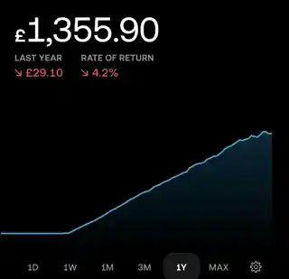

*Updated 25 November 2026: [jump to the latest update](#november-update).* 

Back in February, I set myself a simple challenge. Instead of spending £5 on little things that are quickly forgotten, I would invest it every single day.

No stock picking. No trying to predict the market. Just £5 a day into a global index fund and let time do the work.

It's now been <strong>131 days</strong>, so here's how it's going.

<h3>The numbers</h3>
<ul>
	<li><strong>Days invested:</strong> 131</li>
	<li><strong>Total invested:</strong> £655</li>
	<li><strong>Current portfolio value:</strong> £707.73</li>
	<li><strong>Gain:</strong> £52.73</li>
	<li><strong>Overall return:</strong> Just over 8%</li>
</ul>
Watching the portfolio pass the <strong>£700</strong> mark was a nice milestone. More importantly, it shows just how quickly small, regular investments can grow.
<h3>It's become automatic</h3>
The biggest surprise hasn't been the return.

It's how quickly investing £5 each day became normal.

When I started, I wondered whether it would feel like a chore. Instead, it has become another background habit, much like brushing my teeth or checking the weather.

I don't think about whether the market is up or down. The investment goes in regardless.

That consistency removes the temptation to try and time the market, something most investors fail to do successfully anyway.
<h3>Coffee money adds up</h3>
People often say that giving up coffee won't make you rich.

They're right.

But this challenge was never really about coffee.

It was about proving that lots of small financial decisions, repeated consistently, can make a noticeable difference.

£5 doesn't feel significant today.

After 131 days, it has turned into more than <strong>£700</strong>.

Keep doing it for years, and the numbers become much more interesting.
<h3>The plan hasn't changed</h3>
I'm sticking with the challenge for the rest of 2026.

That means contributing around <strong>£1,825</strong> over the course of the year, before any investment growth.

Trading 212 currently estimates the portfolio could be worth around <strong>£1,960</strong> by February 2027. That's only a projection, of course. Markets rise and fall, and past performance tells us nothing about future returns.

What I can control is continuing to invest every day.
<h3>Final thoughts</h3>
One of the themes of Decluttered Bytes is that meaningful change rarely comes from one huge decision.

It comes from lots of small ones.

Investing £5 a day won't transform your finances overnight, but it has already changed the way I think about money. Instead of asking, “Can I afford this?”, I increasingly find myself asking, “Would I rather own a little more of the global economy?”

Most of the time, the answer is yes.

<h2 id="november-update">25 November 2026: 279 days later</h2>

It's been just over nine months since I started this little experiment on 19 February. Back in July, I was sitting on a healthy gain. This time, the numbers tell a rather different story.

My Trading 212 pie is now worth <strong>£1,355.90</strong>. The app is showing a loss of £29.10 and a rate of return of minus 4.2%.

<em>My £5-a-day portfolio on 25 November 2026.</em>

<h3>The numbers, then and now</h3>

| | July update | 25 November 2026 |
| --- | ---: | ---: |
| Days (as recorded at each update) | 131 | 279 elapsed |
| Portfolio value | £707.73 | £1,355.90 |
| Gain / loss | +£52.73 | −£29.10 |
| Return as reported at the time | Just over 8% | −4.2% |

The November percentage is the rate of return displayed by Trading 212, rather than a simple gain divided by contributions, so the two percentages are not necessarily calculated on the same basis.

The portfolio is worth £648.17 more than it was in July. That's not £648.17 of investment growth, though. Most of that increase comes from continuing to put money in. The rising blue line in the screenshot is a good illustration of why it's important to distinguish the value of an account from the performance of its investments.

<h3>What happens when the numbers turn red?</h3>

It's easy to write about investing when everything is green. Seeing a gain on the screen makes you feel as though you're doing something right. But I wanted to update this article when the figures were red, too. Otherwise, it wouldn't be a particularly honest account of the experiment.

A £29.10 loss isn't particularly exciting, but it's a useful reminder that a global index fund can go down as well as up. It isn't a savings account, and there are no guaranteed returns. Nine months is also a very short period in the context of long-term investing.

The point of investing £5 every day is that I don't have to decide whether today is a good day to buy. When prices are lower, the same £5 buys a little more of the fund; when they're higher, it buys a little less. That doesn't guarantee a profit, but it takes the decision about timing out of my hands.

<h3>It's still only a fiver</h3>

The thing I find most interesting is that a relatively small amount of money has gradually become a portfolio worth over £1,350. A fiver is easy to spend without thinking. Repeated often enough, it becomes something rather more substantial.

The original aim was never to make a quick profit. It was to build a habit that could continue in the background without having to think about it every day.

I'm approaching the first anniversary on 19 February 2027. A full 365 days of £5 contributions would amount to £1,825 before any gains or losses. I'll be interested to see where the portfolio stands by then, but I'm not going to pretend I know what the market will do between now and February.

For now, the plan remains the same. Keep it simple, keep the costs manageable and keep going.

I'll revisit the numbers at the one-year mark, whether they're green or red.

*This is a record of my own investing experiment, not financial advice. Investments can fall in value and you may get back less than you invest.*
