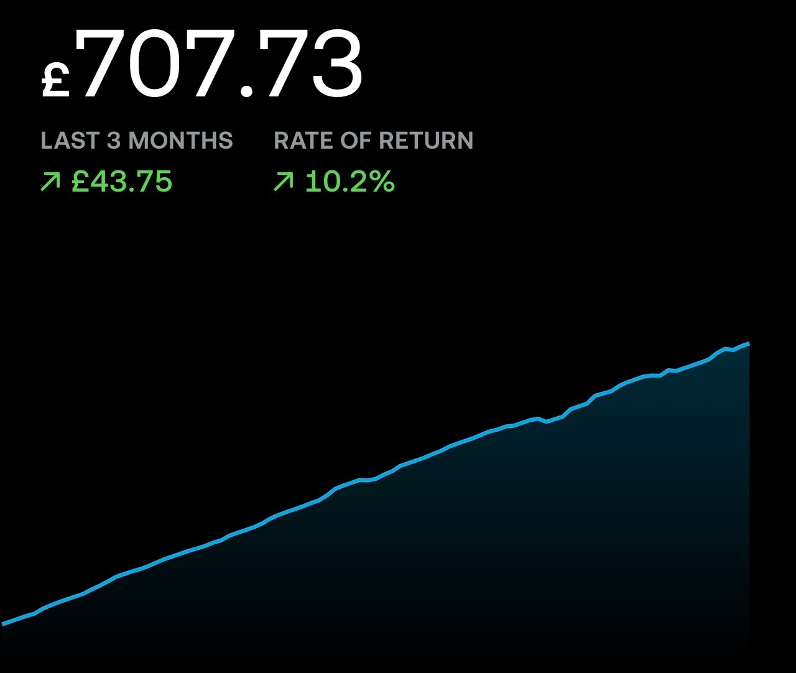

Back in February, I set myself a simple challenge. Instead of spending £5 on little things that are quickly forgotten, I would invest it every single day.

No stock picking. No trying to predict the market. Just £5 a day into a global index fund and let time do the work.

It's now been <strong>131 days</strong>, so here's how it's going.

<h3>The numbers</h3>
<ul>
	<li><strong>Days invested:</strong> 131</li>
	<li><strong>Total invested:</strong> £655</li>
	<li><strong>Current portfolio value:</strong> £707.73</li>
	<li><strong>Gain:</strong> £52.73</li>
	<li><strong>Overall return:</strong> Just over 8%</li>
</ul>
Watching the portfolio pass the <strong>£700</strong> mark was a nice milestone. More importantly, it shows just how quickly small, regular investments can grow.
<h3>It's become automatic</h3>
The biggest surprise hasn't been the return.

It's how quickly investing £5 each day became normal.

When I started, I wondered whether it would feel like a chore. Instead, it has become another background habit, much like brushing my teeth or checking the weather.

I don't think about whether the market is up or down. The investment goes in regardless.

That consistency removes the temptation to try and time the market, something most investors fail to do successfully anyway.
<h3>Coffee money adds up</h3>
People often say that giving up coffee won't make you rich.

They're right.

But this challenge was never really about coffee.

It was about proving that lots of small financial decisions, repeated consistently, can make a noticeable difference.

£5 doesn't feel significant today.

After 131 days, it has turned into more than <strong>£700</strong>.

Keep doing it for years, and the numbers become much more interesting.
<h3>The plan hasn't changed</h3>
I'm sticking with the challenge for the rest of 2026.

That means contributing around <strong>£1,825</strong> over the course of the year, before any investment growth.

Trading 212 currently estimates the portfolio could be worth around <strong>£1,960</strong> by February 2027. That's only a projection, of course. Markets rise and fall, and past performance tells us nothing about future returns.

What I can control is continuing to invest every day.
<h3>Final thoughts</h3>
One of the themes of Decluttered Bytes is that meaningful change rarely comes from one huge decision.

It comes from lots of small ones.

Investing £5 a day won't transform your finances overnight, but it has already changed the way I think about money. Instead of asking, “Can I afford this?”, I increasingly find myself asking, “Would I rather own a little more of the global economy?”

Most of the time, the answer is yes.
