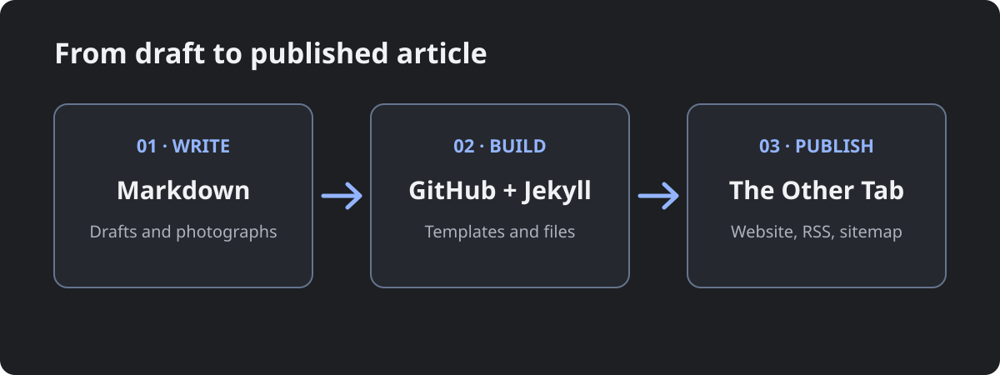

There is something appealing about having a small corner of the internet that belongs to you. Somewhere to write about whatever interests you, without worrying about an algorithm, a posting schedule or whether everything fits into a particular niche.

That is the idea behind The Other Tab. As a Computer Science teacher with interests ranging from technology and gaming to photography and digital minimalism, I wanted a place where those subjects could sit alongside one another.

Building it also gave me an excuse to explore how much of a modern website you can put together without paying for a monthly hosting package.

## Keeping the costs down

I decided to use GitHub Pages rather than a traditional web hosting service. It takes the files in a repository and publishes them as a website. For a personal blog, the free service is a good fit, provided you stay within its usage limits.

The domain name is registered through Porkbun, and I have configured it to point to GitHub Pages. HTTPS is enabled, and I have an email address on the domain that forwards messages to my existing inbox.

There are no monthly hosting charges for the current setup. The recurring cost is the domain renewal, although that could change if I ever need additional paid services.

## How it works

The website uses Jekyll, a static site generator. Instead of storing articles in a database, I write them as Markdown files. Each has a few lines of metadata at the top, including a title, category, description and publication date.

Jekyll turns those files into web pages using shared templates. When I publish a new article, the homepage, archive, RSS feed and sitemap can all be regenerated automatically.

The nice thing about this approach is that the content remains separate from the design. I can change the appearance of the website without rewriting every article. I also have a version history through Git, so changes are not simply lost when I update a file.

## Building my own publishing tools

One of the more interesting parts of the project has been developing a private article editor, which has grown into a local publishing dashboard called The Other Tab Studio.

The idea is to manage drafts, photographs, short notes and personal pages in one place. It can prepare Markdown files and associated images for upload to GitHub, without needing to make my writing workspace publicly accessible.

I have kept the final publishing step manual. It means I can check exactly what is going into the public repository before committing anything.

I used AI to help develop the site and its tools. That made it much easier to experiment with layouts and features, but it did not remove the need to make decisions, test things and occasionally fix problems.

## What about performance and privacy?

A static website has relatively little work to do when somebody visits. There is no database to query or application server to generate each page on demand.

I have also avoided advertising, external fonts and embedded social media widgets. The site offers light and dark modes, selectable accent colours and a reading layout that can be adjusted to suit the visitor.

For basic readership statistics, I chose Cloudflare Web Analytics. Getting it working was a small reminder of how effective DNS filtering can be: AdGuard was blocking the analytics script on my home network. Once I identified the problem and corrected the local filtering, the requests went through successfully.

The first measurements were encouraging, with a reported page load time of 181 milliseconds. That was only a tiny sample, so it is not a promise of performance for every visitor.

## Knowing when to stop

The biggest challenge with building a blog is probably knowing when to stop building it.

There is always another feature to add, another colour to adjust or another way to organise the navigation. It is particularly easy to get distracted by those things when you enjoy technology.

But the point of The Other Tab is not to have the most elaborate website. It is to have somewhere to write, share photographs, explore ideas and document things I find interesting.

The infrastructure is in place. Now comes the part that matters: creating something worth reading.
