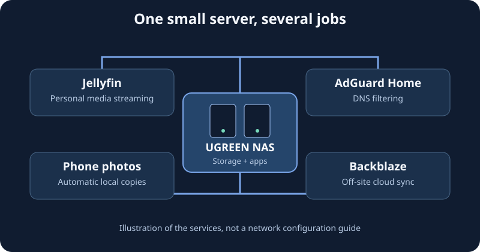
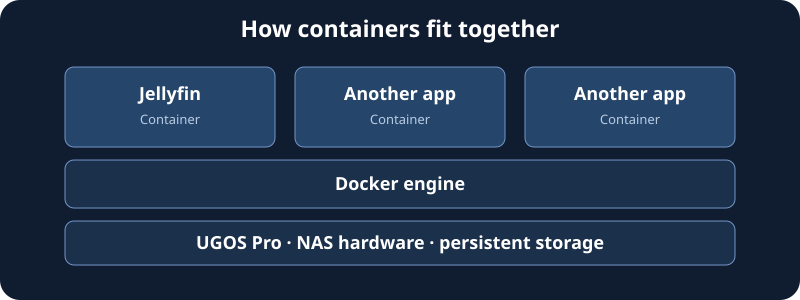
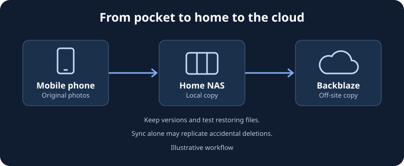

There's something satisfying about having your own little corner of the internet sitting at home. Somewhere to keep your photographs, stream your music and films, and run useful services without needing a separate computer for each job.

I bought my UGREEN NASync DXP2800 from Amazon, and it has been excellent. What has impressed me most is how easy it was to set up. It's a small, relatively unassuming box, but it has become far more useful than a simple network hard drive.

I use it to run Jellyfin in Docker, AdGuard and other services, automatically back up photographs from my mobile phone, and sync data to Backblaze for an off-site copy.

## What exactly is a NAS?

NAS stands for Network Attached Storage. Instead of plugging an external hard drive into one computer, you connect a storage device to your home network so multiple devices can access it.

Modern NAS devices are effectively small computers in their own right. They have a processor, memory, an operating system and the ability to run applications independently.

<figure style="text-align:center"><figcaption>The compact two-bay DXP2800. Manufacturer product image via Scan.</figcaption></figure>

The DXP2800 is a particularly interesting example because it uses an Intel processor rather than being designed solely for basic file storage.

| Specification | UGREEN NASync DXP2800 |
|---|---|
| Processor | Intel N100, four cores |
| Memory | 8GB DDR5 supplied, expandable to 16GB |
| Drive bays | Two 3.5-inch or 2.5-inch SATA drives |
| SSD expansion | Two M.2 NVMe slots |
| Network | 2.5 Gigabit Ethernet |
| System storage | 32GB eMMC |
| Display output | HDMI 2.0, up to 4K |
| Operating system | UGOS Pro |

It is sold as an enclosure, so you need to factor in the cost of suitable storage drives separately. The specifications above are for the standard model, rather than a list of the drives or upgrades installed in my own unit.

[View the product specifications at Scan](https://www.scan.co.uk/products/2-bay-ugreen-nasync-dxp2800-desktop-nas-35-25-sata-2x-m2-8gb-ddr5-usb-32-gen2-25gbe-4k-hdmi-32gb-emm).

## Getting started without making it a project in itself

One of the things I like about the UGREEN is that I haven't needed to build an entire server from scratch just to get started.

UGOS Pro provides a graphical interface for managing storage, users, applications and backups. For someone interested in self-hosting, that is a good middle ground: you can get the fundamentals working through the interface and explore more advanced services as you become comfortable.

For a new owner, the basic process is to install compatible drives, connect the NAS to the router using Ethernet, initialise it, configure the storage pool and create the shared folders you need.

I'd also recommend installing updates, using a strong unique administrator password and enabling multi-factor authentication wherever supported.

What makes the NAS worthwhile for me is everything it does after that initial setup.

## Jellyfin: my own media server

I've previously written about [moving towards my own music library with FLAC, Jellyfin and Finamp](/articles/ditch-spotify-build-flac-jellyfin-finamp/). The NAS gives that collection a permanent home.

[Jellyfin](https://jellyfin.org/) is free, open-source media server software. It lets you organise your own films, television programmes and music, and access them from supported devices around the house.

Rather than installing Jellyfin directly into the underlying system, I run it in a Docker container.

Docker packages an application with its dependencies. Its configuration and media can be stored in persistent directories on the NAS, so the application can be replaced or updated without having to rebuild the whole machine. Persistent data still needs backing up, of course.

The Intel N100 is another useful part of the specification. Its integrated graphics can support hardware-accelerated video transcoding through Intel Quick Sync, provided the container has the required device access and Jellyfin is configured correctly. Transcoding converts a video into a format or quality that a playback device can handle. Direct play avoids that conversion altogether.

The [Jellyfin container installation guide](https://jellyfin.org/docs/general/installation/container/) and [hardware acceleration documentation](https://jellyfin.org/docs/general/post-install/transcoding/hardware-acceleration/) are good starting points if you want to explore this yourself.

## AdGuard: a quieter home network

Another useful service I run is AdGuard. [AdGuard Home](https://adguard.com/en/adguard-home/overview.html) can act as a DNS resolver and filter for devices on your network.

When an application requests a domain associated with advertising or tracking, the filter can stop the lookup from resolving. Devices configured to use the service can benefit without each needing a separate browser extension.

It is not a magic solution to every advert. In particular, DNS filtering cannot reliably distinguish adverts from wanted content when they come from the same domain. Some sites or applications may also need exceptions.

The appeal is that one small server can provide a useful shared service for the household.

If you try this, remember that the NAS becomes part of your network's DNS infrastructure. Plan for what happens if the NAS is switched off or undergoing maintenance, and avoid exposing the DNS administration interface to the public internet.

## Automatic mobile phone photo backup

This is perhaps one of the most practical reasons to own a NAS.

Most of us carry hundreds or thousands of photographs on our phones. It is easy to forget that these are valuable personal files, particularly when changing devices feels as simple as signing into an account.

I use the NAS to back up the photographs from my mobile phone. Instead of leaving everything on the phone itself, I have a copy on storage that I control at home.

The advantage is not simply having more space. It is knowing where the files are and being able to organise them independently of a particular phone manufacturer or cloud photo service.

<figure><figcaption>UGREEN's illustration of a NAS serving multiple devices. Product imagery via Scan, not a photograph of my home setup.</figcaption></figure>

It is worth checking that automatic uploads are actually completing, especially if Android's battery optimisation settings restrict background activity. Before deleting photographs from a phone, make sure the originals have been copied successfully.

## Backblaze: why I still use the cloud

Owning a NAS does not mean abandoning cloud storage entirely. In my case, the NAS also syncs data to Backblaze.

I think this is an important distinction. A home NAS gives me control and convenient local access. Off-site storage helps protect against the possibility of something happening to the equipment at home.

A useful principle here is the **3-2-1 backup rule**:

- Keep three copies of important data, including the original.
- Use two different storage media or independently managed storage systems.
- Keep at least one copy off-site.

This is a principle to aim for, rather than a claim that my particular arrangement meets every requirement for every file. For example, deleting an original from a phone may leave only two copies.

There is another distinction worth making: RAID is not a backup. Mirroring two drives can help you cope with one drive failing, but it won't protect you against every accidental deletion, theft, ransomware incident or disaster.

Similarly, a cloud sync can replicate unwanted deletions or changes. Version retention, separate backup copies and occasional test restores are worth thinking about. Backblaze provides cloud storage that can form part of such a strategy; the precise protections depend on how you configure your account and backup software.

## Is it cheaper than cloud storage?

Potentially, but it depends on what you use it for.

Buying a NAS means paying for the enclosure, the drives and the electricity to keep it running. Drives can fail and may eventually need replacing. Off-site storage can also involve an ongoing charge.

The value for me is that the same device provides storage, media streaming, network services and backups. I am not buying a NAS solely to save a few pounds on a cloud subscription.

You also take on some responsibility for maintenance and security. Keep the operating system and containers updated, back up their configuration, and think carefully about remote access. A private VPN is often preferable to opening management ports directly to the internet.

## Would I recommend the DXP2800?

Based on my experience, absolutely. It has been straightforward to set up and has proved useful for a surprising variety of everyday tasks.

There are reasons to consider a larger NAS if you need more drive bays, extensive expansion or substantial storage growth. Two bays place a physical limit on how many SATA drives you can install, and the initial purchase is only part of the overall cost.

But for a home user looking to run a handful of services, keep personal media in one place and take greater control of photographs and backups, the DXP2800 is an appealing option.

What I like most is that it brings several things I care about together: owning my digital media, using open-source software, reducing unnecessary dependence on subscriptions and making technology work for me.

Sometimes the most useful computer in your house is the one you rarely have to think about.

---

**Useful links**

- [UGREEN NASync DXP2800 official product page](https://ai.ugreen.com/products/ugreen-nasync-dxp2800-nas-storage)
- [Jellyfin documentation](https://jellyfin.org/docs/)
- [AdGuard Home](https://github.com/AdguardTeam/AdGuardHome)
- [Backblaze cloud storage](https://www.backblaze.com/cloud-storage)

*I purchased this NAS from Amazon myself. The Scan link is provided for reference. The product images are manufacturer imagery via Scan; the explanatory diagrams were created for this article and do not show my precise network configuration.*
