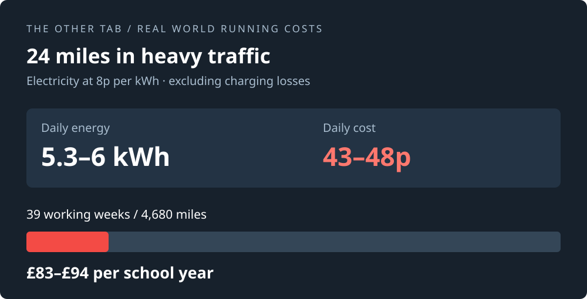

There is a tendency to judge electric cars by how far they can travel on a single charge, how quickly they can recharge and how much technology they can squeeze into the dashboard. All useful things, but none necessarily make a car better suited to the journey I actually make every day.

My car is a bright-red, 2017 Nissan Leaf Tekna with the 30kWh battery. It is the original generation of Leaf, not the later model. Nearly a decade after it was registered, it is hardly at the cutting edge of electric motoring.

Yet for my 24-mile daily commute, often in heavy traffic, it makes an enormous amount of sense.

*Cover photograph: a 2017 Nissan Leaf Tekna 30kWh in the same bright-red colour as mine. [Makizox / Wikimedia Commons](https://commons.wikimedia.org/wiki/File:2017_Nissan_Leaf_Tekna_30kWh_Front.jpg), [CC BY-SA 4.0](https://creativecommons.org/licenses/by-sa/4.0/). Reference photograph, not my own vehicle.*

## From a Citroën C1 to a Leaf

Before the Leaf, I owned a 2017 Citroën C1. I paid £4,200 for it and kept it for four years. When I traded it in, I was offered £4,000.

That is just £200 in depreciation over four years, excluding the other costs of ownership. I doubt many new cars could come close to that.

The Leaf cost £6,000. With the C1 taken in part exchange, the cash difference was £2,000. For that I moved into a larger, quieter, more comfortable automatic car, in the top-of-the-range Tekna trim.

| | Amount |
|---|---:|
| Original C1 purchase price | £4,200 |
| C1 part exchange | £4,000 |
| Leaf purchase price | £6,000 |
| Cash difference | £2,000 |

It is worth distinguishing the cash difference from the value of the Leaf itself. It was still a £6,000 car; I simply already had £4,000 of equity in my previous vehicle.

## The daily commute

My commute is 24 miles a day and involves a considerable amount of heavy traffic. This is where the Leaf is at its best.

There is no clutch to operate, no engine idling at traffic lights and no waiting for a cold engine to warm up. Regenerative braking recovers some energy as the car slows, and the electric motor makes crawling along much less tiring than driving a manual car.

The Tekna specification helps too. Heated seats and steering wheel, a Bose sound system and the around-view parking cameras are useful features that still feel worthwhile today. The infotainment system looks its age, but the things that make a car pleasant to use have not suddenly stopped working because newer models exist.

## Less than 50p a day

I charge at home on Intelligent Octopus Go, at an overnight rate of 8p per kWh. My typical efficiency is between 4 and 4.5 miles per kWh.

That means my commute uses around 5.3 to 6kWh of energy, costing approximately 43 to 48p before charging losses.

| Driving | Estimated electricity cost |
|---|---:|
| 24-mile commute | 43–48p |
| Five-day working week | £2.13–£2.40 |
| 39 working weeks | £83–£94 |
| 10,000 miles | £178–£200 |

These are battery-energy estimates rather than measured electricity bills. Charging losses, winter heating and occasional public charging will increase the actual cost.

For comparison, a petrol car returning 55mpg at £1.70 a litre would cost about £658 in fuel over the same 4,680-mile school-year commute. That is an illustrative comparison, not a measured figure for my former C1.

On those assumptions the difference is roughly £570 a year before charging losses. Fuel savings alone could therefore make a meaningful contribution towards the £2,000 cash difference over several years. Insurance, vehicle tax, servicing and depreciation still need to be considered separately.

## The battery question

My Leaf's battery state of health is around 78%. Battery degradation is real, and it is one of the most important things to check when considering an older Leaf.

The original 30kWh figure is nominal capacity, so multiplying it by the reported state of health is not a precise way of establishing usable range. Temperature, driving speed, battery condition and the car's reserve all matter.

But my typical commute uses less than 6kWh. The battery does not need to be anywhere near its original capacity to cover that comfortably.

This is the distinction I think gets lost in discussions about old EVs. A battery that is no longer suitable for somebody's long-distance commute can still have years of useful service in a car that mainly travels locally.

The Leaf lacks active liquid cooling for the traction battery, and repeated rapid charging or sustained hot conditions can be a disadvantage. When buying one, I would want to see battery health information, check for unusually weak cells where possible and test the car on a representative journey.

*Rear view of the same reference car. [Makizox / Wikimedia Commons](https://commons.wikimedia.org/wiki/File:2017_Nissan_Leaf_Tekna_30kWh_Rear.jpg), [CC BY-SA 4.0](https://creativecommons.org/licenses/by-sa/4.0/).*

## Where the age shows

The Leaf uses CHAdeMO for rapid charging, rather than the CCS standard used by most newer EVs in the UK. Charger availability on a particular route is something I would check before travelling. It is not a car I would buy specifically for frequent long motorway journeys.

On longer trips I plan conservatively, especially in cold weather. A rapid top-up can still be useful, but it is a different experience from a modern long-range EV with much faster charging.

The range also falls in colder weather and at motorway speeds. My usual 4–4.5 miles per kWh is not a guarantee for every journey.

For my normal routine, however, home charging largely removes the need to think about public infrastructure.

## Electric does not mean maintenance-free

An older EV is still an older car. Tyres, suspension, brakes and other mechanical parts wear.

On my Leaf I have replaced front lower suspension arms on both sides and the drop links, and uneven front tyre wear has also been something to investigate. These are reminders that buying an EV does not mean escaping the ordinary realities of car ownership.

There is no engine oil or exhaust system to maintain, but I would still budget for repairs and inspect an older Leaf carefully before buying.

## Would I buy one today?

If I had a similar commute and access to inexpensive home charging, I would certainly consider one again.

I would pay more attention to the individual battery and mechanical condition than to the age of the number plate alone. I would also make sure the car had sufficient winter range for my longest regular journey, with a comfortable reserve.

If I depended entirely on public charging or frequently travelled hundreds of miles, I would look elsewhere. A newer EV with a larger battery and CCS charging would be a more flexible choice.

For me, buying hundreds of miles of extra range to cover a 24-mile commute would be solving a problem I rarely have.

## Still worth it?

THE OTHER TAB / STILL WORTH IT?

<h3 style="margin:12px 0">2017 Nissan Leaf Tekna · 30kWh</h3>

<strong>Purchase price:</strong> £6,000 <strong>Cash difference after part exchange:</strong> £2,000 <strong>Typical efficiency:</strong> 4–4.5 miles/kWh <strong>Battery health:</strong> approximately 78% <strong>Best for:</strong> commuting and local journeys with home charging <strong>Main compromises:</strong> limited range, battery ageing and CHAdeMO

Verdict: Still worth it, for the right journeys.

The original Leaf is not the best electric car you can buy today. It does not need to be.

It is a comfortable, practical way of getting to work for very little money, and a reminder that the sensible option is not necessarily the newest one. Sometimes the technology we already have, or can buy second-hand, is more than good enough.

*Beyond the hype. Beyond the upgrade cycle. Is it still worth it?*
